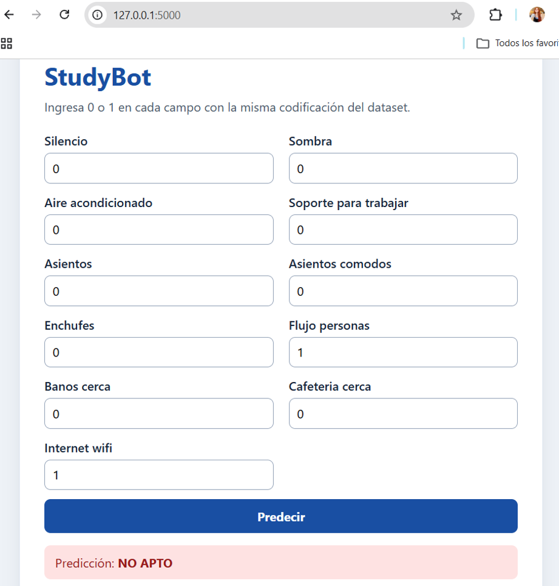
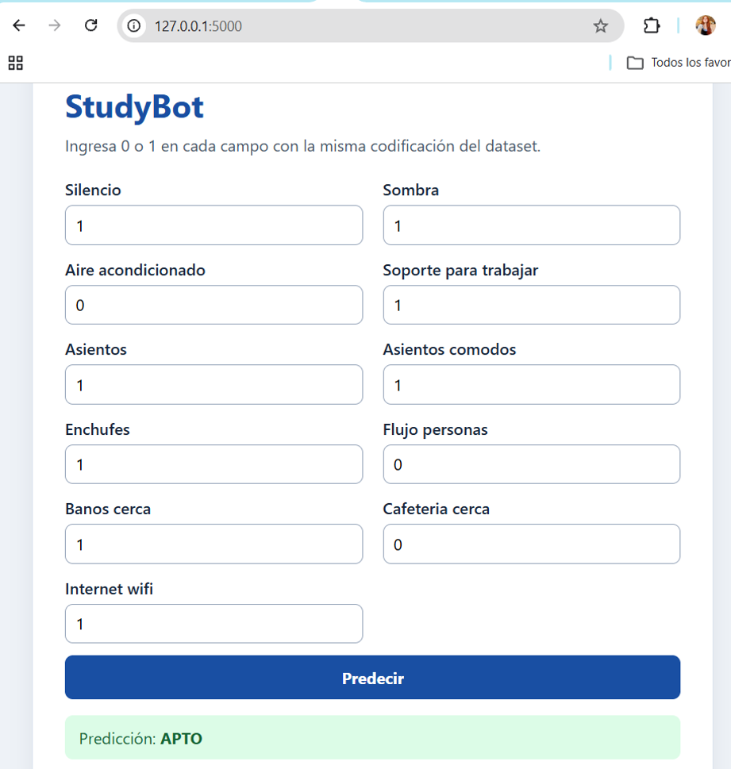
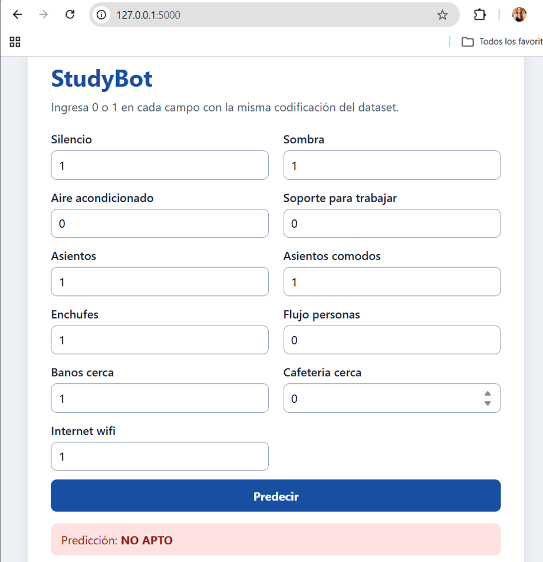

# StudyBot

StudyBot es una aplicación web que clasifica un lugar como **APTO** o **NO APTO** para trabajar. Utiliza el árbol de decisión entrenado con el Dataset v1.0 de la segunda entrega.

## Cómo ejecutar la aplicación en Windows

Abre PowerShell en la carpeta del proyecto y ejecuta estos comandos:

```powershell
python -m venv .venv
.\.venv\Scripts\python.exe -m pip install -r requirements.txt
.\.venv\Scripts\python.exe -m flask --app app run
```

Abre [StudyBot](http://127.0.0.1:5000), ingresa `0` o `1` en cada campo y presiona **Predecir**.

## Pruebas en Flask

Al iniciar, la aplicación carga `studybot_model.joblib` con `joblib.load()`. Al enviar el formulario, ordena los valores según las columnas guardadas y llama a `predict()` sobre el árbol cargado.

| Campo | Prueba 1 | Prueba 2 | Prueba 3 |
| --- | ---: | ---: | ---: |
| `silencio` | 0 | 1 | 1 |
| `sombra` | 0 | 1 | 1 |
| `aire_acondicionado` | 0 | 0 | 0 |
| `soporte_para_trabajar` | 0 | **1** | **0** |
| `asientos` | 0 | 1 | 1 |
| `asientos_comodos` | 0 | 1 | 1 |
| `enchufes` | 0 | 1 | 1 |
| `flujo_personas` | 1 | 0 | 0 |
| `banos_cerca` | 0 | 1 | 1 |
| `cafeteria_cerca` | 0 | 0 | 0 |
| `internet_wifi` | 1 | 1 | 1 |
| **Resultado en Flask** | **NO APTO** | **APTO** | **NO APTO** |

### Prueba 1 — NO APTO

El modelo clasificó el lugar como **NO APTO** cuando solo `flujo_personas` e `internet_wifi` tenían valor `1`.



### Prueba 2 — APTO

El modelo clasificó como **APTO** un lugar con silencio, sombra, soporte para trabajar, asientos cómodos, enchufes, baños cerca y wifi.



### Prueba 3 — NO APTO

Al cambiar únicamente `soporte_para_trabajar` de `1` a `0` respecto a la prueba 2, la predicción pasó de **APTO** a **NO APTO**. Este par de entradas muestra una frontera de decisión del modelo.



## Preguntas

1. **¿Qué contiene `studybot_model.joblib`?** Contiene el árbol de decisión entrenado y los nombres de las 11 columnas en su orden de entrenamiento.
2. **¿Por qué evitar `fit()` en la aplicación?** `fit()` ajusta el modelo con datos de entrenamiento. La aplicación carga el árbol ya entrenado y usa `predict()` para clasificar nuevas entradas.
3. **¿Por qué usar el mismo preprocesamiento?** El modelo espera que cada valor tenga el mismo significado y ocupe la misma posición que durante el entrenamiento. En StudyBot esto implica conservar la codificación binaria y el orden de las columnas.
4. **¿Qué cambia al desplegar la aplicación?** En local, el servidor de desarrollo de Flask permite probar la aplicación en mi computadora. En producción, la aplicación se ejecuta en un entorno configurado para atender solicitudes de otros equipos.